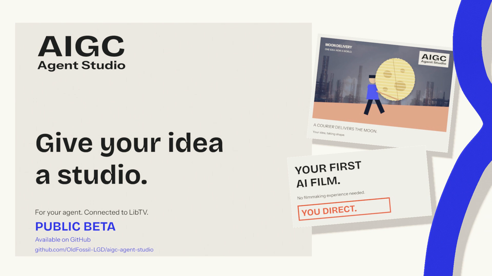

# AIGC Agent Studio

## Product preview

[Watch or download the preview](https://github.com/OldFossil-LGD/aigc-agent-studio/releases/download/v1.0.1-beta.1/AIGC_Agent_Studio_Public_Beta.mp4).

**Public Beta**

A LibTV-based filmmaking skill for AI agents. Use it to develop a script, review a storyboard, plan assets and prepare shots for production on LibTV.

**For the production workflow, connect LibTV to your agent through MCP or the LibTV CLI and sign in with your own LibTV account.** Canvas operations, model generation and production execution use that connection. Script review and the offline prompt demo can run before you connect LibTV.

Give the agent a brief in plain language. It uses the filmmaking reference library to work through the task, keeps track of your requirements and checks the result before delivery. The Python tools handle structured handoffs, prompt compilation and offline checks.

## Connect LibTV to your agent

Install the complete skill folder in your agent host, then set up a LibTV connection. Your host needs access to the skill files and one of these tool interfaces.

| Connection | What the agent needs |
| --- | --- |
| MCP | A remote HTTP MCP client with OAuth support. Add the LibTV server and authorize your own account. |
| CLI | Shell access to the official `libtv` executable, a signed-in CLI session and access to the project files. |

The Python platform executors included here invoke the LibTV CLI. Install the CLI too when using those scripts, including in an agent that already has an MCP connection.

Follow the [LibTV connection guide](docs/LIBTV_SETUP.md) for official installation sources, authentication and a read-only connection check. Confirm the target account and canvas before allowing platform changes. Media generation needs separate approval and may use LibTV credits.

## What you can use it for

- Develop and review scripts, including character motivation and scene structure.
- Plan characters, props and locations, then check continuity across shots.
- Work on storyboards, camera placement, lighting, visual style and sound.
- Analyze references or revise part of an existing project.
- Prepare a production plan and execute approved production steps on LibTV through the connected agent.

To use the skill, copy the complete folder into your agent host's configured skill directory and have the agent read [SKILL.md](SKILL.md). Describe the result you want. For example,

> Review this storyboard. Check who initiates the handover, whether the final possession state is clear, and whether the action is physically reachable. Do not generate media.

A review task can end with a review. Prompts can be delivered as text. Film production also needs generation approval, current platform information, media review and assembly.

## Try the offline demo

This example exercises local prompt compilation. To work on a LibTV canvas or generate media, complete the connection setup above.

Install Python 3.10+ and run these commands from the project folder.

~~~bash
python -m pip install -r requirements.txt
python scripts/compile_intent_delivery.py samples/papercut_empty_shot_intent.en.json --out out/demo --draft
~~~

The sample asks for a five-second vertical paper-cut shot with a clock shadow, a blue wall, a fixed overhead camera, negative space and rain only. It produces a draft prompt with these statuses.

~~~text
gate_status: PASS
contract_status: READY
verification_status: PASS
delivery_readiness: DRAFT_REVIEW_REQUIRED
output: out/demo/13_Draft_Prompt.md
~~~

PASS and READY refer to the declared engineering constraints. Final delivery requires a current review record. Removing `--draft` without that record returns a nonzero exit code and creates no current Final. The [demo notes](docs/DEMO.md) include captured output and rejected inputs.

The offline demo runs without an API key or LibTV. Agent/model usage and approved platform generation can have separate costs.

## How the workflow fits together

~~~mermaid
flowchart LR
  B[Natural-language brief] --> A[Agent: task and endpoint]
  A --> C[Consider domains and select sources]
  C --> R[Read full applicable sources and exceptions]
  R --> D[Task-grounded choices and artifact draft]
  D --> V[Check actual artifact and current evidence]
  V -->|missing or inconsistent| W[Draft or unresolved review]
  V -->|evidence valid| F[Evidence-reviewed text or plan]
  F --> L[LibTV connected through MCP or CLI]
  L --> P[Separately approved platform and media workflow]
~~~

The agent considers the library's domains, reads the sources relevant to the task and checks their exceptions before using them. The catalog helps find those sources. Changed or unregistered files require a catalog review and rebuild.

User requirements and agent proposals stay separate in the internal handoff. Unsupported creative fields raise validation errors. A Final needs current task, source and output evidence, together with independent checks of supported constraints. An unreviewed rerun archives an older generated Final.

The graph fixtures are synthetic, so you can test schema and lineage failures without the original private project. Source hashes and review records check consistency. Artistic judgement and media quality need their own review. The [delivery protocol](references/delivery-review.md) describes the review requirements.

See the [case study](docs/case-study.md) for implementation choices and the [evaluation notes](docs/EVALUATION.md) for test coverage.

## Install the Python tools

Use the complete repository or release archive, including the entry file, reference library, schemas and scripts.

The tools require Python 3.10+ and jsonschema >= 4.0. A virtual environment keeps the dependencies separate from other projects.

In PowerShell, activation is optional.

~~~powershell
python -m venv .venv
.venv\Scripts\python.exe -m pip install -r requirements.txt
.venv\Scripts\python.exe scripts/compile_intent_delivery.py samples/papercut_empty_shot_intent.en.json --out out/demo --draft
~~~

On POSIX systems, run the following commands.

~~~bash
python3 -m venv .venv
.venv/bin/python -m pip install -r requirements.txt
.venv/bin/python scripts/compile_intent_delivery.py samples/papercut_empty_shot_intent.en.json --out out/demo --draft
~~~

After installation, run the checks with that environment's Python.

~~~bash
python -m unittest discover -s tests -v
python scripts/knowledge_catalog.py
python scripts/fidelity_regression.py
python scripts/verify_recovery_index.py
~~~

The [local verification record](docs/evidence/verification.json) lists the tested source files and commands. Local checks used Windows with Python 3.13.14. The workflow matrix covers Windows and Ubuntu with Python 3.10, 3.11 and 3.13. The badge above links to its current status.

For the bundled platform executors, set `LIBTV_BIN` to the LibTV executable, put `libtv` on PATH or use the official current-user installation. Complete CLI login as described in the [connection guide](docs/LIBTV_SETUP.md). Each user supplies their own LibTV authorization.

## Project map

| Path | Purpose |
| --- | --- |
| [SKILL.md](SKILL.md) | Agent entry and routing rules |
| [references](references/) | Filmmaking guidance, source catalog and labelled historical material |
| [scripts](scripts/) / [schemas](schemas/) | Compilers, contracts, validators and platform adapters |
| [samples](samples/) / [tests](tests/) / [evals](evals/) | Example inputs, regressions and evaluation fixtures |
| [docs](docs/) | Demo, implementation notes, evaluation and publication details |

## Scope and limits

This release is a public Beta. Interfaces, documentation and production workflows may change as the project is tested in more agent environments. Report the agent host, connection method and revision when filing an issue.

The offline tools check text, plans and supported declared constraints. Generated motion, contact, clipping and sound need to be checked against actual media. Source selection and artistic judgement still depend on the agent and reviewer. A creator study and finished-media evaluation have yet to be carried out.

Historical examples need an applicability check for each task. Model capabilities and prices need current platform evidence. The [publication notes](docs/PUBLICATION_BOUNDARIES.md) cover data handling and reference material.

## Credits and license

Developed by jiangchenxi using AI-assisted coding. The [contribution notes](docs/CONTRIBUTIONS.md) describe project decisions, AI assistance and upstream work.

The library draws on Hell Grind AIGC Skill, AIGC Film Studio and screenwriting-skills, among other sources. [Related work](docs/RELATED_WORK.md) describes their documented scope alongside the local implementation.

See [LICENSE](LICENSE) for the project terms and [THIRD_PARTY_NOTICES.md](THIRD_PARTY_NOTICES.md) for upstream notices and unresolved provenance. jiangchenxi has selected MIT for the project. Some third-party redistribution checks remain open.
